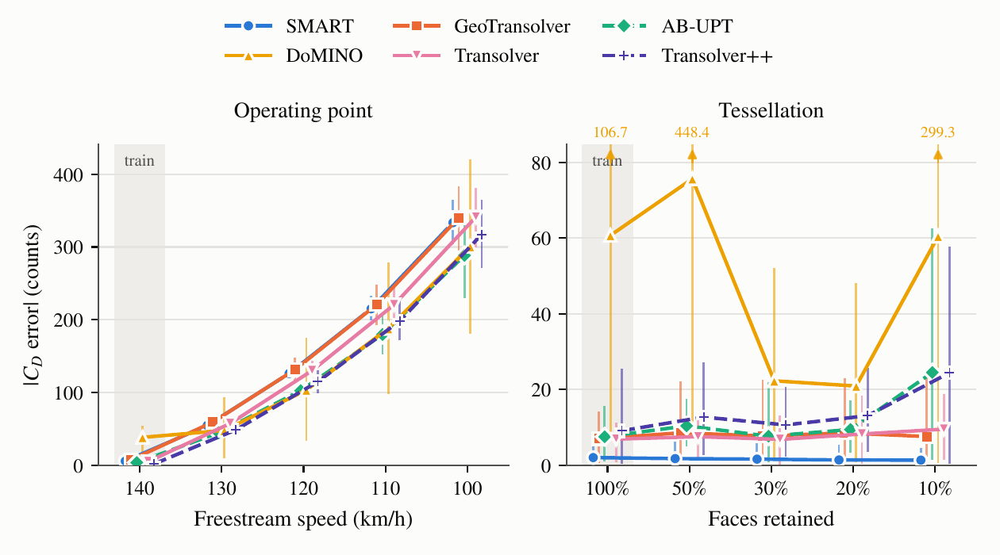
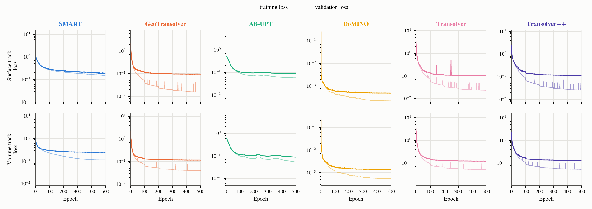

# SHIFT-Truck: review figures

## Fig. 6 (updated): distribution shifts

Drag error |C_D| in counts for the six models, against freestream speed (left) and against the share
of surface faces retained (right). The grey band marks the training condition.

## Fig. R2: training and validation curves

Training (thin) and validation (thick) loss over 500 epochs for the six models, surface track (top)
and volume track (bottom), log scale.

License: CC BY-NC 4.0, full text in `LICENSE`.
